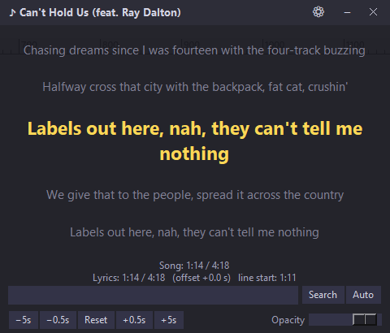

# 🎵 Lyrics Overlay

A lightweight Windows application that displays synced lyrics of the currently playing song (YouTube, Spotify, or any media player that supports Windows Media Controls) in a small always-on-top window.

## ✨ Features

- 🎵 **Automatic detection** of the currently playing song via the Windows Media API
- 🔍 **Seven lyrics sources** searched automatically: lrclib.net, NetEase Cloud Music, KuGou, QQ Music, Musixmatch, Megalobiz and Genius
- 🎯 **Smart matching**: results are checked against the song title, artist and duration, so a different song with a similar name is not picked; weak matches are shown with a warning
- ⚡ **Fast**: the search stops as soon as a trusted result is found and never waits more than 10 seconds for slow services
- 💾 **Remembers results**: a song you already found opens instantly next time, without searching
- ▸ **Next result**: not the right lyrics? Press **Next ▸** to try the next-best result; when the list ends, the other services are searched more thoroughly
- 📝 **Unsynced fallback**: if only plain lyrics exist, they are shown with estimated timing
- 🖱️ **Manual search** if the song isn't found automatically
- ⚙️ **Adjustable offset** (±0.5s, ±5s, reset), **remembered per song**
- 👆 **Click any line** to set it as the current sync point
- 📜 **Mouse-wheel scrolling** in both directions (returns to the live line after a few seconds)
- 🎨 **Nine themes** (Dark, Pure black, Midnight purple, Ocean blue, Forest, Sunset, Neon, Light, Paper) and **eight active-line colors** (or the theme's own accent)
- 🌫️ **Fading lines**: the current line is big and bright, the lines around it fade out
- 🫥 **Clean look**: the buttons and search box only appear when you move the mouse over the window
- 🪟 **Transparent mode**: no window background, only the lyrics floating on your screen (with an outline so they stay readable)
- 🔤 **Font and text size** choices; resize the window with the corner grip
- 🔆 **Opacity control** (30% – 100%)
- 🖱️ **Right-click** the lyrics to open the settings menu (also works in transparent mode)
- 💾 **Settings are remembered** (position, opacity, theme, color)
- 📌 **System tray icon** with Show / Hide / Exit
- 🪟 **Draggable window** that snaps to the screen edges and the taskbar (can be turned off), and always reopens on a visible screen
- 🧾 **Log file** (⚙ → Open log file); credit lines such as 作词/作曲/Producer are hidden showing which sources were tried for each song
- 🚫 **No ads, no accounts**

## 📋 Requirements

- Windows 10 or Windows 11
- Python 3.8 or newer (`winsdk` may not have packages for the very newest Python releases; use the Python version it installs on)
- Packages listed in `requirements.txt`

## 🚀 Installation

1. Clone or download this repository.
2. Install the required packages: `pip install -r requirements.txt`
3. Run the application: `python lyrics_overlay.pyw` or just double-click the file.

## 🎮 Usage

- Start playing a song on YouTube, Spotify, or any supported media player.
- The lyrics will appear automatically.
- If the wrong lyrics appear or the sync is off:
  - Press **Next ▸** to see the next-best result.
  - Use the **Search** box to manually enter the song name (e.g. `artist song`); **Auto** searches again from scratch.
  - Use the **±0.5s** / **±5s** buttons to fine-tune the offset.
  - **Click any lyric line** at the moment it is sung to set the sync point.
  - Use the **mouse wheel** to look at earlier or later lines.
- Move the mouse over the window to show the controls. Click the **⚙** icon (or right-click the lyrics) for the theme, colors, font, text size, transparent background, auto-hide and the log file.
- Click the **−** icon to hide the window to the system tray (available when the tray icon is working).
- Click the **✕** icon to exit.

If a song is not found, open the log file from the ⚙ menu. It lists the searches that were made and which services answered.

## ⚙️ Files

Settings are stored in `%USERPROFILE%\.lyrics_overlay_settings.json` (delete it to reset the application).
The log is stored in `%USERPROFILE%\.lyrics_overlay.log`.
Saved lyrics are stored in `%USERPROFILE%\.lyrics_overlay_cache.json` (⚙ → Clear saved lyrics to empty it).

## 🔒 Privacy

There are no accounts and no analytics. To find lyrics, the song title, artist and duration reported by your media player are sent to lrclib.net, music.163.com (NetEase), kugou.com, qq.com and, if installed, Musixmatch, Megalobiz and Genius.

NetEase, KuGou, QQ Music, Musixmatch, Megalobiz and Genius are used through unofficial interfaces, so they may stop working at any time. The application keeps working with the remaining sources.

## 📄 License

This project is licensed under the MIT License — see the LICENSE file for details.

## 🙏 Credits

- Lyrics from [lrclib.net](https://lrclib.net), NetEase Cloud Music, KuGou, QQ Music, Musixmatch, Megalobiz and Genius
- Built with winsdk, musicxmatch-api, syncedlyrics, pystray, and Pillow

## ⭐ Support

If you find this project useful, please consider giving it a star on GitHub!
